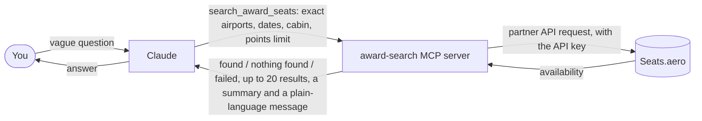
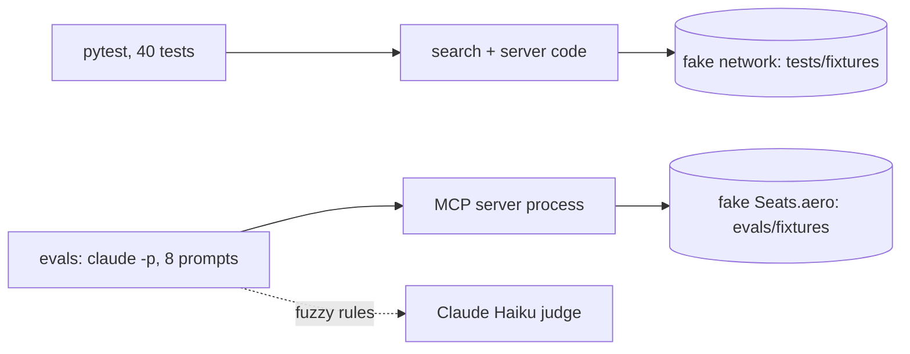

# award-search-mcp

[](https://github.com/g-dominguez/award-search-mcp/actions/workflows/tests.yml)

A read-only MCP server that lets an AI agent answer award seat questions ("any premium economy seats from Nice to LA in mid-July under 75k?") using the [Seats.aero](https://seats.aero) partner API. Availability data comes from Seats.aero. See `PLAN.md` for the decisions and how the project was built stage by stage, and `GLOSSARY.md` for terms.

## Example

This is a real Claude Code conversation from the evals, run against made-up data. Seats.aero's terms don't allow publishing their real availability.

> **You:** any premium economy seats from Nice to LA in mid-July under 75k?

Claude turns the vague parts into exact arguments and calls the tool twice: once with the limit, then without it to see how far off the cheapest seats are.

```json
{"origins": ["NCE"], "destinations": ["LAX"], "start_date": "2027-07-10", "end_date": "2027-07-20", "cabin": "premium", "points_limit": 75000}
{"origins": ["NCE"], "destinations": ["LAX"], "start_date": "2027-07-10", "end_date": "2027-07-20", "cabin": "premium"}
```

> **Claude:** No. I found nothing under 75k for Nice (NCE) to Los Angeles (LAX) in premium economy for July 10–20, 2027. To see how far off that is, I ran the same search with no points limit. It found 17 flights, and all of them have one stop. The cheapest is 98,000 points:
>
> | Program | Flights | Points | Taxes | Dates (seats left) |
> |---|---|---|---|---|
> | Flying Blue | Air France via Paris (AF9321/AF9020), departs 06:10 | 98,000 | $352 | Jul 11 (6), 12 (9), 13 (5), … |
> | Flying Blue | KLM via Amsterdam (KL9472/KL9601), departs 06:25 | 98,000 | $360 | Jul 15 (6), 17 (5), 18 (1) |
> | Delta SkyMiles | Air France + Delta via Paris, departs 09:40 | 125,000 | $56 | Jul 13 (1), Jul 20 (2) |
>
> This data was last updated about 2 hours ago. Confirm the price on the Flying Blue or Delta site before you transfer any points.

## How it works



Claude does the interpreting ("mid-July" → July 10–20, "London" → LHR and LGW). The server only takes exact codes and dates, filters each flight against the search, sorts by fewest points per seat and returns a status that the agent can't mistake: a failed search never looks like "no seats". The API key stays on the server and never reaches the model.

Tests and evals both replace Seats.aero with saved, made-up responses, so they never use the real API:



## Design decisions worth a look

Each one is explained in `PLAN.md`, with the evidence behind it.

- **A failed search never looks like "no seats".** Every result is `found`, `nothing_found` or `failed`, with a message telling the agent what that means. The evals check this with an outage and a bad key.
- **Unknown isn't zero.** Real data showed American reports `0` seats on almost every available flight, meaning the count is unknown, not that none are left. Treating it as zero hid nearly all American results.
- **The 20-result cap can't hide dates or airports.** Evals showed Claude needing 3–4 searches to see past the cap. A summary of all matches by route and date or month brought that down to one.
- **Duplicate searches don't use API quota.** Claude sometimes sends the same search twice at once. Identical searches share one API call.
- **Evals caught real behaviour, not just bugs.** Claude sometimes guessed 12 destinations for "anything from Nice in mid-July?", so the tool description now tells it to ask. That case has passed every run since.
- **The public repo only holds made-up data.** Seats.aero's terms don't allow publishing flights more than 60 days out, so the fixtures are generated by `evals/make_fixtures.py`.

## Setup

```sh
python3 -m venv .venv
source .venv/bin/activate
pip install -r requirements.txt
python -m pytest
```

Tests run offline against saved responses in `tests/fixtures/`, and run automatically on GitHub for every push (see `.github/workflows/tests.yml`). All fixtures are made-up flights in Seats.aero's response format, since Seats.aero's terms don't allow publishing their data for flights more than 60 days out.

## Run the server

```sh
export SEATS_AERO_API_KEY=...   # your Seats.aero partner API key
python -m award_search.server
```

It talks MCP over stdio, so it's meant to be started by an MCP client such as Claude Desktop or Claude Code rather than used directly.

### Use it from Claude Code

`.mcp.json` registers the server for this project. It passes `SEATS_AERO_API_KEY` through from your shell, so the key is never written to a file. One way to keep the key out of dotfiles is the macOS Keychain:

```sh
security add-generic-password -a "$USER" -s seats-aero-api-key -w   # paste the key when asked
# then in ~/.zshrc:
export SEATS_AERO_API_KEY="$(security find-generic-password -a "$USER" -s seats-aero-api-key -w)"
```

Start `claude` in this folder, approve the `award-search` server, and check it with `/mcp`.

## Evals

```sh
.venv/bin/python -m evals.run_evals --repeat 3     # every case 3 times
.venv/bin/python -m evals.run_evals old_data       # one case
```

Each case runs a prompt through `claude -p` against a fake Seats.aero (made-up responses in `evals/fixtures/`, generated by `python -m evals.make_fixtures`), so no real API calls are made. Results are saved in `evals/results/` and compared with the previous run. A full `--repeat 3` run is 24 Claude conversations plus a few judge calls, so it uses some Claude usage.
